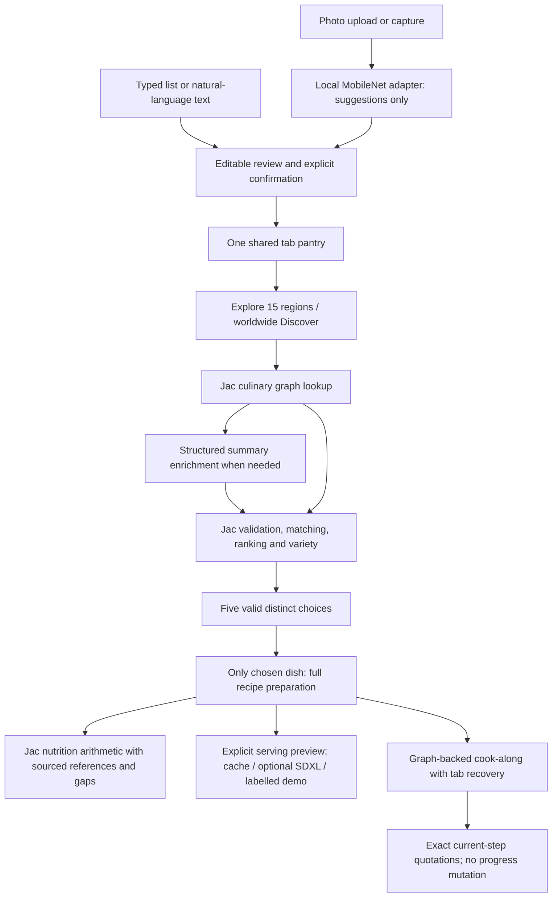

# Cooksy: implemented architecture

Jac implements the UI, typed HTTP RPC, nodes/edges/walkers, orchestration,
validation, deterministic matching/ranking/nutrition and public cache policy.
Python is limited to specialist vision/SDXL adapters. CSS supplies visual design;
JavaScript files under tests are browser tooling, not application logic.

`pantry/client_state` owns the confirmed tab basket and result snapshots.
`discovery` supplies graph taxonomy, intake review, scope/variety/five-choice rules
and shared UI. `walkers/enrichment` consults graph coverage before structured model
calls. `ai` validates/provenances summaries and selected preparation. `cooking`
recovers graph state against recipe content versions. `vision` binds reviewed
predictions to confirmed ingredients. `nutrition` uses the small sourced reference
subset; `previews` owns recipe-grounded image state and its graph cache.

Public culinary and preview caches are bounded process memory, not durable account
data. Private pantry, photos, questions and cooking sessions are not attached to
anonymous shared roots. Photos are decoded in memory by a bounded local worker.
Generated image data URLs are process-cached, not saved image files. No live SDXL
provider is configured. Current vision is a limited prominent-object classifier.

Two-stage culinary generation is preserved: candidate summaries first, one full
recipe only on selection. A discovery action permits one initial summary request
and one bounded repair; partial sets cannot be selected. Navigation/reload restore
existing exact graph identities without inference. Nutrition loads references without inference. An explicit AI-estimate endpoint can fill food/portion gaps with labelled assumptions; Jac keeps totals and known reference values.
Preview generation requires an explicit selected-recipe action. Ingredient
confirmation and provider/error disclosures remain part of the product flow.
